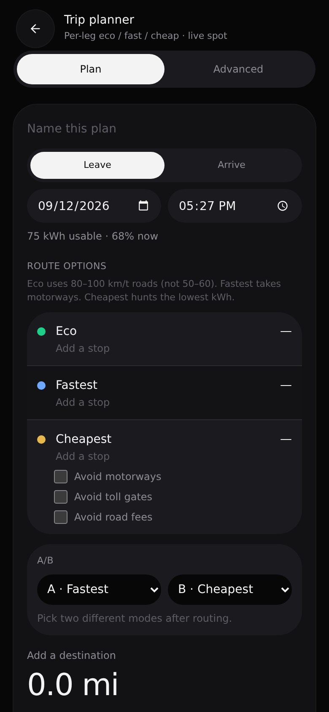
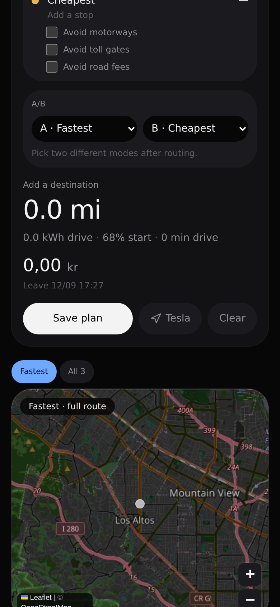
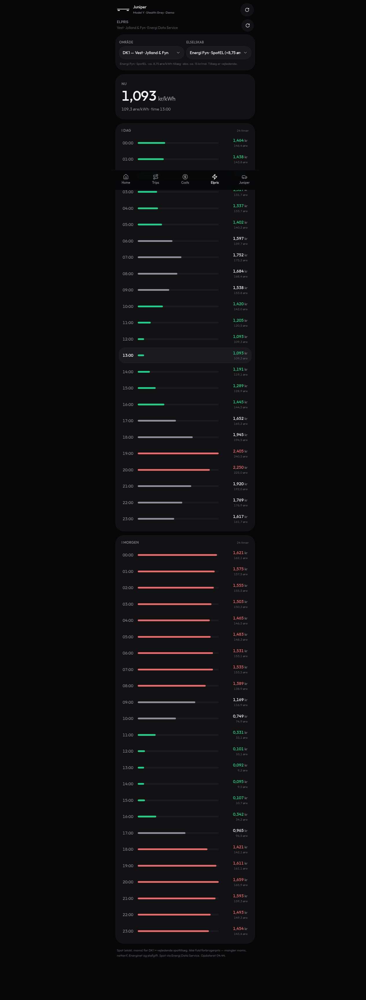

# tesla_trip

A dark, mobile-first EV trip planner for a Tesla, with Danish spot prices.

Two tabs: the **Planner** (start page) and **Elpris**. Nothing here talks to the car.

---

## Features

### Trip planner
Three corridors for the same stops. It is the start page; old [`/plan`](/plan) links redirect there.

The planner has three panes. **Plan** is the trip. **Advanced** is the car model, km or miles, the battery, and the search radius. **Memberships** is which networks you pay for. A membership applies to every pane.



**Stops.** Add a stop at the top. Tap a stop to change the address. The first stop gets a leave time; later stops stay on Auto until you set leave or arrive. A later arrival time moves the start leave back by the drive time. Tap the time note to edit it.

**Routes.** Eco, Fastest, and Cheapest stay independent. Expand a mode to see every stop, including each charge as its own via with kWh and price.

| Mode | What it optimizes |
| --- | --- |
| Eco | 80–100 km/t roads. Uses a highway when it is the sensible road, not a motorway by default. A route about twice as slow as Fastest is penalized. |
| Fastest | Motorways and the shortest time. Tolls and road fees are allowed. If you prefer a network, Fastest uses only that network. |
| Cheapest | Lowest charging price inside the search radius. Stays on the preferred network unless another stall in that radius is actually cheaper. Avoid motorways, tolls, or road fees with the toggles on this row. |

**Charging.** A stop is required if arrival would fall under 25%, and the plan never arrives below 8%. A normal fill goes to 80%. An optional stop in the 26–45% band is suggested only when the price is good and it adds at least 20%.

**Preferred network.** Pick one network you already subscribe to. Fastest will not substitute another brand. Cheapest starts there and leaves it only for a better price in the search area.

**Advanced.** Set usable battery kWh, a general kWh/mi, and the state of charge for this plan only. Charge-search distance is shared by the modes. Per-speed consumption (50 / 80 / 110 / 130 km/t) is in kWh/100 km. `kWh/mi = (kWh/100 km) × 0.0161`.

**In and out.** Paste a Google Maps or Apple Maps link to import stops. Export the edited trip back to Google Maps, Apple Maps, or Tesla nav. Save uses “start → end” until you rename it, and stores the start date, total time, and cost. Clear asks before it wipes the draft. Saved plans can be opened again from the planner.



### Elpris
Danish day-ahead prices from Energi Data Service, plus the retailer tillæg.



- **DK1** (west) or **DK2** (east)
- Elselskab list: spot and retailers with tillæg
- This hour, today, and tomorrow
- Hours that have already passed are dimmed; tomorrow starts collapsed

## Tabs

| Tab | Route | What it does |
| --- | --- | --- |
| Planner | `/` | Plan, Advanced, Memberships |
| Elpris | `?tab=elpris` | DK spot and retailer prices |

---

## Stack

- **UI:** React 19, TanStack Router/Start, Tailwind CSS 4, Zustand
- **Maps:** Leaflet and OpenStreetMap
- **Routing:** OSRM and Valhalla. Chargers from OpenChargeMap along the polyline
- **Prices:** Energi Data Service (DK1/DK2) and a catalog of EU networks, including site rates where they vary by hour
- **Data:** On-device demo stores. PGlite migrations are available

---

## Run locally

```bash
npm install
npm run dev
```

The dev server and planner are at [http://localhost:8080](http://localhost:8080).

```bash
npm run typecheck
npm test
npm run build
```

---

## Privacy

Saved plans and settings stay on this device. Address search calls Nominatim only when you search. Charger search calls OpenChargeMap only for the route you are planning. Nothing here starts, stops, or unlocks the car.

Screenshots live in [`docs/readme/`](docs/readme/).
